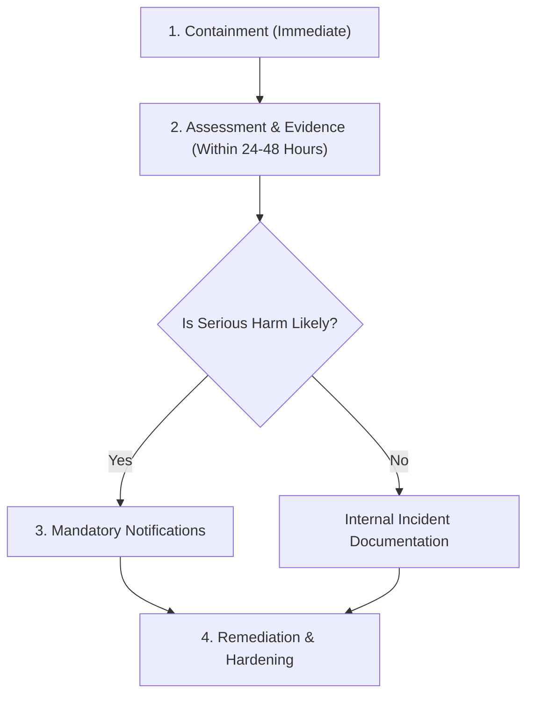

# Solar CRM — Privacy & Regulatory Compliance Notes
**Document Version:** 1.0  
**Effective Date:** November 2026  
**Jurisdictions Covered:** India (IN) and Australia (AU)  
**Applicable Subsystems:** Leads, Outreach, Messaging, Surveys, Quotes, Audit Logging, and Data Retention

---

## 1. Statutory Legal Disclaimer
> [!IMPORTANT]
> **LEGAL NOTICE & DISCLAIMER**  
> This software and documentation provide technical, operational, and data governance **controls** designed to facilitate compliance with applicable laws in India and Australia. **This software does NOT constitute legal advice.**  
> 
> Telemarketing laws, consumer protection rules, data privacy regulations, tax rates (GST), and renewable energy incentive programs (such as PM Surya Ghar in India and STCs / rebate schemes in Australia) change frequently. The operating business entity must consult a qualified legal advisor and compliance professional in each respective jurisdiction to review call scripts, opt-in disclosures, retention policies, and cross-border data transfer arrangements before conducting live customer operations.

---

## 2. Overview of CRM Compliance Controls

The Solar CRM provides automated, architectural guardrails to enforce privacy, respect consumer preferences, and maintain immutable accountability:

| Control Area | Technical Implementation | Purpose & Benefit |
| :--- | :--- | :--- |
| **Consent & Opt-In** | `consent_status`, `consent_source`, `consent_date` fields on `Lead`. | Records verified provenance and timestamp of consent prior to commercial outreach. |
| **Multi-Channel Opt-Out** | Discrete flags: `opt_out_calls`, `opt_out_sms`, `opt_out_whatsapp`, `opt_out_email`, and master `do_not_contact`. | Respects granular customer preferences; blocks disallowed channels automatically in the service layer. |
| **Calling Hours Enforcement** | `check_calling_hours()` evaluated strictly in the **lead's local timezone** (considering state boundaries and daylight saving). Configurable per region as `warn` (requires typed justification reason) or `block`. | Enforces statutory telemarketing windows (e.g., Australian 09:00–20:00 weekdays, 09:00–17:00 Saturdays, prohibited Sundays and public holidays). |
| **Do Not Call Registers** | `dncr_status`, `dncr_checked_at`, `dncr_checked_by` fields on `Lead`. | Tracks screening against the Australian Do Not Call Register (DNCR) or Indian National Customer Preference Register (NCPR/DND). |
| **Tamper-Evident Audit Trail** | Immutable `AuditLog` table: `.save()` and `.delete()` raise `ValueError` on any modification or deletion. | Retains non-repudiable logs of call-hour overrides, privacy exports, data corrections, and anonymizations. |
| **Data Subject Rights** | Dedicated API endpoints: `/api/leads/{id}/privacy-export/` (JSON & PDF dossier), `/api/leads/{id}/anonymize/`, and `/api/leads/{id}/privacy-correct/`. | Enables immediate fulfillment of Data Subject Access Requests (DSAR) and Right to be Forgotten. |
| **Data Minimization (AI Assist)** | Anonymized context builder in `ai_assist`: strips full names, phone numbers, email addresses, and street addresses before AI analysis. Strict prompt guardrails prevent hallucinating tariffs or statutory rebate amounts. | Mitigates data leakage risk and complies with statutory data minimization mandates. |

---

## 3. Mapping to Indian Legal & Regulatory Framework

### 3.1 Digital Personal Data Protection (DPDP) Act, 2023
* **Notice & Consent (Section 5 & 6):**  
  Every lead record tracks `consent_source` (e.g. "Website Form", "Solar Expo", "Partner Referral") and `consent_status`. CSV import enforces capturing consent provenance.
* **Data Principal Rights (Sections 11–13):**
  * *Right to Access:* Administrators can generate a complete Data Subject Access Request (DSAR) dossier via `GET /api/leads/{id}/privacy-export/?format=pdf` or JSON.
  * *Right to Correction:* Administrators can rectify inaccurate records with `POST /api/leads/{id}/privacy-correct/` requiring a typed reason logged in `AuditLog`.
  * *Right to Erasure / Anonymization:* `POST /api/leads/{id}/anonymize/` permanently redacts name, phone, email, and address into anonymous aggregate transaction history.
* **Data Minimization & Purpose Limitation (Section 8):**  
  Data collection is restricted to rooftop technical feasibility, billing consumption, and contact details. Outbound AI coaching strips all direct identifiers.

### 3.2 TRAI Telecom Commercial Communications Customer Preference Regulations (TCCCPR, 2018)
* **Permitted Calling Windows:**  
  Commercial communications in India are restricted to **09:00 to 20:00 local time**. The CRM calculates calling windows in `Asia/Kolkata` time and warns or blocks outbound calls outside these hours.
* **National Customer Preference Register (NCPR / DND):**  
  Leads marked `do_not_contact` or `opt_out_calls` are barred in code from telephone and WhatsApp campaigns.
* **Transactional vs. Promotional Communications:**  
  Appointment reminders and survey confirmations are categorized as transactional service messages; general offers are categorized as promotional with explicit opt-out handling.

---

## 4. Mapping to Australian Legal & Regulatory Framework

### 4.1 Privacy Act 1988 & Australian Privacy Principles (APPs)
* **APP 1 (Open & Transparent Management):**  
  System configuration includes editable privacy policy links and notices stored in `Region.privacy_notice_text`.
* **APP 2 (Anonymity & Pseudonymity):**  
  Leads can be pseudonymized or irreversibly anonymized using `/api/leads/{id}/anonymize/`.
* **APP 3 & APP 5 (Collection & Notification):**  
  `consent_source` and `consent_date` record when and how collection notices were acknowledged.
* **APP 7 (Direct Marketing):**  
  Outbound telemarketing, SMS, and email marketing require active consent. Discrete channel opt-outs (`opt_out_sms`, `opt_out_calls`) allow recipients to unsubscribe from specific media without losing survey or warranty notifications.
* **APP 12 & APP 13 (Access & Correction):**  
  The DSAR dossier generator produces a formatted PDF dossier documenting all recorded interactions, surveys, quotes, and audit logs. Rectifications require an explicit audit record.

### 4.2 Spam Act 2003
* **Express & Inferred Consent:**  
  SMS messages can only be sent if `opt_out_sms` and `do_not_contact` are false and `consent_status == 'consented'`.
* **Identity & Functional Unsubscribe Facility:**  
  All SMS message templates in Australia append the region's mandatory opt-out text (`Region.opt_out_line_text`, e.g., *"Reply STOP to opt out"*).

### 4.3 Do Not Call Register (DNCR) Act 2006
* **Register Screening:**  
  Under the DNCR Act, telemarketing calls to Australian numbers must not be made if the number is on the Do Not Call Register, unless express consent exists. The CRM stores `dncr_status` (`not_on_register`, `on_register`, `exempt`), `dncr_checked_at`, and `dncr_checked_by`.
* **30-Day Re-check Validity:**  
  `Region.dncr_validity_days` (default 30 days) tracks when screening must be refreshed.
* **Permitted Telemarketing Calling Hours (Telemarketing and Research Industry Standard 2017):**
  * **Monday to Friday:** 09:00 to 20:00 (local recipient time).
  * **Saturday:** 09:00 to 17:00 (local recipient time).
  * **Sundays & Public Holidays:** Strictly **prohibited**.
  * The CRM's `check_calling_hours()` derives the lead's state timezone (handling AEDT/AEST differences in NSW, VIC, QLD, SA, WA, TAS, NT, ACT) and blocks Sunday calling by default for Australian leads. Calling outside permitted hours requires a typed override reason that is permanently recorded in `AuditLog`.

---

## 5. Data Breach Response Checklist (NDB Scheme & DPDP Act)

If an unauthorized disclosure, security compromise, or accidental loss of personal data occurs:

### Step 1: Containment (Hours 0–4)
- [ ] Isolate compromised user accounts: change passwords, revoke active JWT sessions in database/cache.
- [ ] Terminate unauthorized API keys or suspect background tasks.
- [ ] Freeze affected database rows and preserve application logs and `AuditLog` records for forensic audit.

### Step 2: Assessment & Risk Evaluation (Hours 4–48)
- [ ] Identify which leads and users were accessed or exfiltrated (query `AuditLog` by timestamp and IP address).
- [ ] Determine data categories involved (e.g. names, phone numbers, electricity bills, addresses).
- [ ] Evaluate the likelihood of serious physical, financial, or reputational harm.

### Step 3: Mandatory Regulatory Notifications
* **Australia (OAIC — Notifiable Data Breaches Scheme):**
  - If the breach is likely to result in serious harm to any individual, notify the **Office of the Australian Information Commissioner (OAIC)** and affected individuals as soon as practicable within **30 days**.
  - Submit the OAIC Notifiable Data Breach statement via the OAIC online portal.
* **India (CERT-In & Data Protection Board of India):**
  - Report cyber security incidents to **CERT-In** within **6 hours** of noticing the incident (under the CERT-In Cybersecurity Directions, 2022).
  - Notify the **Data Protection Board of India (DPBI)** and affected data principals pursuant to Section 8(6) of the DPDP Act 2023.

### Step 4: Remediation & Post-Incident Review
- [ ] Implement permanent security patch or architectural correction.
- [ ] Log complete post-mortem report and file in internal compliance repository.

---

## 6. Data Retention Policy & Editable Settings

### 6.1 PolicySettings: `data_retention_days`
The CRM includes an editable `data_retention_days` setting on the `PolicySettings` singleton master (editable via Django Admin and API).

### 6.2 Retention Recommendations by Data Category
1. **Unqualified / Stale Leads (Terminal Status: Lost / Invalid Contact / Merged):**  
   Recommended retention: **180 to 365 days** after the final activity. Stale personal data should be purged or anonymized to reduce exposure under the DPDP Act and Privacy Act.
2. **Won / Commissioned Customers (Accepted Quotations & System Specifications):**  
   Recommended retention: **7 to 10 years** from project completion. Australian and Indian taxation laws (e.g. GST compliance, ATO records, IT Act 1961) require preserving contracts, invoices, and payment records for a minimum of 5 to 7 years.
3. **AuditLog Records:**  
   Append-only and immutable. Recommended retention: **3 to 7 years** for regulatory accountability, dispute resolution, and telemarketing compliance audits.

---

## 7. Cross-Border Data Residency & Cloud Hosting

When operating a unified CRM serving both Indian and Australian customers:
* **Indian DPDP Act (Cross-Border Transfer):**  
  Section 16 permits transfer of personal data outside India, except to countries specifically blacklisted by the Central Government. Australia is not blacklisted.
* **Australian APP 8 (Cross-Border Disclosure):**  
  Before disclosing personal information to an overseas recipient (e.g., hosting databases in AWS/GCP regions in India, Singapore, or the US), the entity must take reasonable steps to ensure the overseas recipient does not breach the Australian Privacy Principles.
* **Recommended Infrastructure Setup:**
  * For enterprise deployments with strict residency requirements: use database partitioning by region (`region == 'IN'` vs `region == 'AU'`) or host database replicas in the primary operational hub with encrypted backups.
  * Enforce TLS 1.3 in transit and AES-256 at rest for all database volumes and object storage.

---

## 8. Multi-Language Messaging & Telecommunications Compliance (Phase 14L)

### 8.1 Distinct Customer Language Settings
- Customer notifications (WhatsApp, SMS, Email) are generated in the customer's preferred communication language (`Lead.preferred_language`), independent of the staff member's interface language.
- Mandated statutory lines (such as Australian Spam Act unsubscribe text `"Reply STOP to opt out"` or Indian regulatory disclosures) are preserved across all language variants.

### 8.2 Telecom Regulatory Approval (DLT in India)
- Under TRAI TCCCPR regulations, customer-facing SMS and WhatsApp templates in India must be pre-registered and approved on telecom DLT (Distributed Ledger Technology) portals.
- The messaging engine prevents dispatching unapproved customer-facing translations (`approval_status == 'pending'`), falling back to registered default templates or raising a clear delivery error.

### 8.3 SMS Encoding & Segment Counting Transparency
- **GSM-7 Standard (Latin / English)**: 160 characters for single segment, 153 characters per concatenated segment.
- **UCS-2 Standard (Hindi / Devanagari / Unicode)**: 70 characters for single segment, 67 characters per concatenated segment.
- Outbound SMS services dynamically evaluate encoding via `calculate_sms_segments()` to give real-time visibility into segment counts and avoid telecommunication surcharge surprises.

