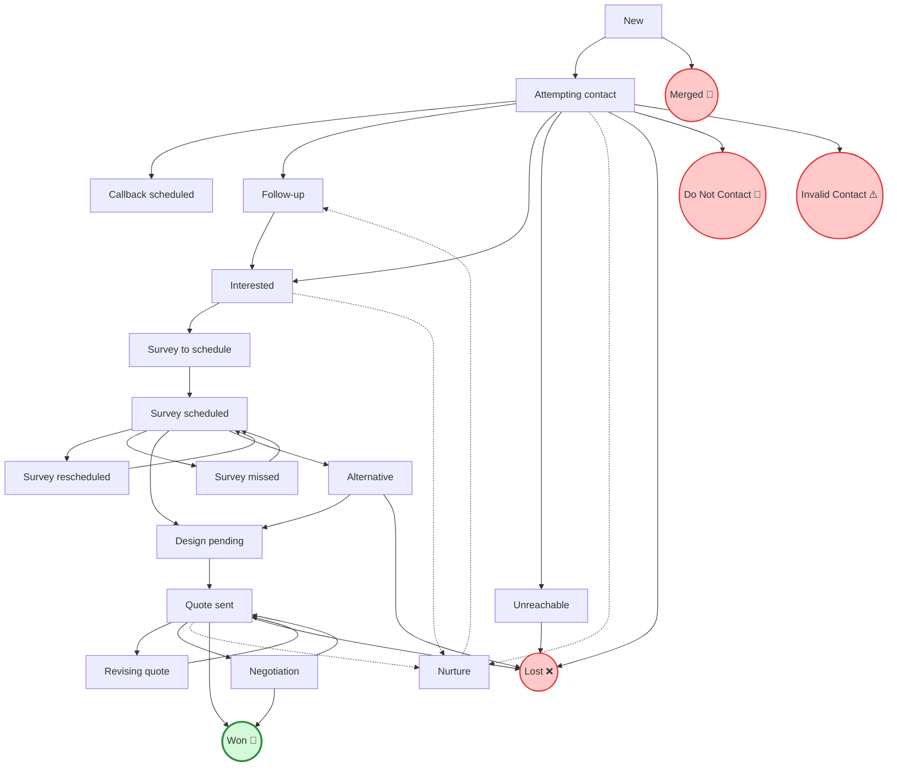

# Solar CRM — Comprehensive User & Operations Manual

---

## 1. Introduction & Executive Principles

**Solar CRM** is a purpose-built customer relationship management platform engineered specifically for residential and commercial rooftop solar installation businesses in India. The application standardizes and accelerates lead acquisition, initial qualification calls, site technical surveys, and quotation negotiations up to the customer commitment point (**"Won"**).

### 1.1 The Golden Business Rule
> **Every call, visit, or interaction must end with an outcome.**
> 
> Each outcome enforces three synchronized attributes on the lead:
> 1. The **Lead Status** (e.g., `Interested`, `Survey scheduled`, `Negotiation`)
> 2. The **Next Action** (e.g., `Book survey date`, `Share revised quote`)
> 3. The **Next Follow-up Date & Time** (e.g., `Tomorrow at 10:00 AM`)
> 
> A lead is **never allowed** to remain without a next follow-up date unless it has entered a terminal status (`Won`, `Lost`, `Do not contact`, `Merged`, or `Invalid contact`).

### 1.2 Strict Scope Boundary
The workflow strictly concludes when a lead reaches **Won** (customer agrees to quotation) or a terminal closure. Post-sales functions (advances, payments, subsidy processing, net-metering liaison, equipment procurement, installation, commissioning, after-sales tickets, warranties, and maintenance) are outside this CRM's operational boundary.

---

## 2. User Roles & Permission Matrix

The system provides 4 role-based permission tiers:

| Feature / Action | Admin | Manager | Salesperson | Surveyor |
| :--- | :---: | :---: | :---: | :---: |
| **View Dashboard & Today's Follow-ups** | Yes | Yes | Yes (Assigned) | Yes (Surveys) |
| **Create & Edit Leads** | Yes | Yes | Yes | Read-only |
| **Log Call Outcomes & Remarks** | Yes | Yes | Yes | No |
| **Book & Reschedule Site Surveys** | Yes | Yes | Yes | Yes |
| **Conduct & Complete Surveys (Mark Done)** | Yes | Yes | Yes | Yes |
| **Create, Send & Revise Quotes** | Yes | Yes | Yes | No |
| **Mark Lead as "Won" (Accept Quote)** | Yes | Yes | Yes | No |
| **Mark Lead as "Lost"** | Yes | Yes | Only with Manager Override | No |
| **Bulk Reassignment & Source Change** | Yes | Yes | No | No |
| **Import CSV / Excel Leads & Undo Batch** | Yes | Yes | View Only | No |
| **Export Leads to Formula-Safe CSV** | Yes | Yes | Yes (Filtered) | No |
| **Edit Masters & Policy Settings** | Yes | Yes | No | No |
| **Manage User Accounts & Roles** | Yes | No | No | No |

---

## 3. All 21 Lead Lifecycle Statuses

### 3.1 Active & Operational Statuses
1. **`New`**: Brand-new lead captured from form, ad campaign, walk-in, or CSV import. Awaiting first outreach.
2. **`Attempting contact`**: Initial call attempts underway (attempts 1 to 4).
3. **`Callback scheduled`**: Prospect answered and explicitly requested a callback at a specific date and time.
4. **`Follow-up`**: General ongoing dialogue (e.g., waiting for family discussion, owner contact details, or technical clarifications).
5. **`Interested`**: Customer has confirmed interest, reviewed initial details/brochure, or discussed bill savings.
6. **`Survey to schedule`**: Customer agreed to a physical site survey; appointment date is being finalized with the surveyor.
7. **`Survey scheduled`**: Survey appointment booked with a designated surveyor at a fixed date and time.
8. **`Survey rescheduled`**: Survey postponed by homeowner request or surveyor unavailability; awaiting new appointment date.
9. **`Survey missed`**: Surveyor visited or attempted to visit, but customer was unavailable or unreachable at site.
10. **`Design pending`**: Site technical survey completed and marked suitable; engineer is drafting roof layout, shadow analysis, and electrical SLD.
11. **`Alternative`**: Roof has space, shading, or structural constraints; salesperson is proposing a customized or smaller capacity system.
12. **`Quote sent`**: Commercial quotation delivered to homeowner (via WhatsApp/Email); awaiting response.
13. **`Revising quote`**: Customer requested adjustments (change panel brand, add battery, resize kW, or request discount); proposal revision in progress.
14. **`Negotiation`**: Customer comparing competitive proposals or negotiating final pricing/payment terms.
15. **`Nurture`**: Customer interested in solar but cannot proceed immediately (house under construction, waiting for loan/budget). Parked for scheduled long-term follow-up (default 90 days).
16. **`Unreachable`**: Lead received maximum call attempts (`MAX_CALL_ATTEMPTS_BEFORE_UNREACHABLE=5`) with no response. Placed on a 14-day cooling-off schedule.

### 3.2 Terminal Statuses (No Further Mandatory Follow-up)
17. **`Won`**: Customer officially approved and agreed to the solar proposal. Process completes successfully.
18. **`Lost`**: Deal closed unsuccessfully. A mandatory `lost_reason` is recorded.
19. **`Do not contact`**: Prospect requested complete removal from contact lists. All outbound communication is permanently locked.
20. **`Merged`**: Duplicate lead record combined into a primary lead record.
21. **`Invalid contact`**: Phone number is out of service, incorrect digits, or wrong person.

---

## 4. Master Outcome Matrix (All 29 Outcomes across 3 Stages)

### Stage 1: Call Outcomes (15 Outcomes)

| # | Outcome Name | Resulting Status | Default Next Action | Default Follow-up | Requires Reason | Terminal? |
| :---: | :--- | :--- | :--- | :---: | :---: | :---: |
| 1 | **No answer** | `Attempting contact` | Retry, then WhatsApp | Dynamic (Rule) | None | No |
| 2 | **Busy or switched off** | `Attempting contact` | Retry at a different time | +1 day | None | No |
| 3 | **Customer asks to call later** | `Callback scheduled` | Call at the time customer gave | Mandatory Manual | None | No |
| 4 | **Wrong or invalid number** | `Invalid contact` | Check form or source for another number | None | None | **Yes** |
| 5 | **Not the decision maker** | `Follow-up` | Ask for decision maker's number or best time | +2 days | None | No |
| 6 | **Interested, wants more info** | `Interested` | Send details, brochure, or sample savings | +2 days | None | No |
| 7 | **Agrees, ready for site survey** | `Survey to schedule`| Book survey date and send confirmation | Mandatory Manual | None | No |
| 8 | **Wants to discuss with family** | `Follow-up` | Offer call with family or short deck | +3 days | None | No |
| 9 | **Price or budget concern** | `Interested` | Share financing, subsidy, and payback info | +3 days | None | No |
| 10 | **Not interested for now** | `Nurture` | Ask when to contact again | +90 days (Manual) | **Nurture** | No |
| 11 | **Not interested at all** | `Lost` | Record the lost reason | None | **Lost** | **Yes** |
| 12 | **Already installed / booked** | `Lost` | Record reason, ask for referral | None | **Lost** | **Yes** |
| 13 | **Rented house / tenant** | `Follow-up` | Ask whether owner can be contacted | +2 days | None | No |
| 14 | **Asked not to be called again**| `Do not contact` | Block calls and messages | None | None | **Yes** |
| 15 | **Duplicate enquiry** | `Merged` | Merge with existing record | None | None | **Yes** |

---

### Stage 2: Survey Outcomes (7 Outcomes)

| # | Outcome Name | Resulting Status | Default Next Action | Default Follow-up | Requires Reason | Terminal? |
| :---: | :--- | :--- | :--- | :---: | :---: | :---: |
| 1 | **Survey booked** | `Survey scheduled` | Send reminder the day before | Mandatory Manual | None | No |
| 2 | **Customer asks to reschedule** | `Survey rescheduled` | Book new date, update reminder | Mandatory Manual | None | No |
| 3 | **Customer not at site / unreachable** | `Survey missed` | Call, rebook, note missed visit | +1 day | None | No |
| 4 | **Surveyor cancels or delayed** | `Survey rescheduled` | Inform customer and rebook | +1 day | None | No |
| 5 | **Survey done, site suitable** | `Design pending` | Prepare engineering design and quote | +2 days | None | No |
| 6 | **Survey done, site not suitable**| `Alternative` | Offer smaller system, else mark Lost | +2 days | None | No |
| 7 | **Customer changes mind before survey** | `Nurture` | Record reason and next date | +90 days (Manual) | **Nurture** | No |

---

### Stage 3: Quotation Outcomes (7 Outcomes)

| # | Outcome Name | Resulting Status | Default Next Action | Default Follow-up | Requires Reason | Terminal? |
| :---: | :--- | :--- | :--- | :---: | :---: | :---: |
| 1 | **Quote sent, no reply** | `Quote sent` | Follow up by call & WhatsApp | +2 days | None | No |
| 2 | **Customer asks questions** | `Follow-up` | Answer and send missing details | +1 day | None | No |
| 3 | **Customer asks for changes** | `Revising quote` | Send revised quote (keep old version) | +1 day | None | No |
| 4 | **Customer compares with vendor** | `Negotiation` | Share differences in warranty & service | +2 days | None | No |
| 5 | **Customer wants to wait** | `Nurture` | Record reason and date to call back | +90 days (Manual) | **Nurture** | No |
| 6 | **Customer agrees** | `Won` | Proposal accepted; process completes | None | None | **Yes (Won)** |
| 7 | **Customer rejects** | `Lost` | Record lost reason (price, competitor, etc.) | None | **Lost** | **Yes** |

---

## 5. Automated Intelligence & Business Rules

### 5.1 The "No Answer" Retry Ladder
To avoid spamming customers while preventing leads from falling through the cracks, logging the **"No answer"** outcome triggers an automated retry algorithm:
- **Attempt 1**: `attempt_count = 1`. Follow-up is scheduled for the **same day, 4 hours later**.
- **Attempt 2**: `attempt_count = 2`. Follow-up is scheduled for the **next day (+1 day)**.
- **Attempts 3 & 4**: `attempt_count = 3 or 4`. Follow-up is scheduled for **subsequent days (+1 to +2 days)**.
- **Attempt 5 (`MAX_CALL_ATTEMPTS_BEFORE_UNREACHABLE`)**: Automatically transitions lead to **`Unreachable`** status with follow-up set to **+14 days** (`UNREACHABLE_FOLLOWUP_DAYS`).
- **Subsequent "No answer" on an Unreachable Lead**: Automatically closes the lead as **`Lost`** with reason `"no response"`.
- **Reset Trigger**: Any incoming response, answered call, or non-"No answer" interaction immediately resets `attempt_count` to 0.

### 5.2 Re-engagement of Dormant Leads
If a customer in **`Lost`**, **`Nurture`**, or **`Unreachable`** contacts the business again:
- The system immediately transitions the lead to **`Follow-up`**.
- Sets the next follow-up date to **today**.
- Resets `attempt_count` to 0.

### 5.3 Role-Gated Loss Authority
- The policy setting `WHO_CAN_MARK_LOST` (default: `"manager"`) prevents junior sales reps from arbitrarily closing out pipeline opportunities.
- Only users with the role of **Manager** or **Admin** can mark a lead as `Lost`.

### 5.4 "Do Not Contact" Privacy Guardrail
- Once marked **`Do not contact`**, the system sets `do_not_contact = true`.
- In the UI, the **Call** and **WhatsApp** action buttons are disabled with a visual alert banner.
- All automated notification jobs and WhatsApp message providers reject outbound dispatches for these leads.

### 5.5 APScheduler Automated Daily Background Jobs
The backend scheduler runs without external dependencies (no Celery/Redis) with Asia/Kolkata timezone:
- **09:00 AM Daily — Morning Follow-up Briefing**:
  - Scans all non-terminal leads where `next_followup_at <= today 23:59:59`.
  - Dispatches targeted notifications to each assigned salesperson summarizing due and overdue calls.
- **06:00 PM Daily — Tomorrow's Site Survey Reminders**:
  - Identifies all site surveys scheduled for the next calendar day.
  - Sends briefing notifications to both the assigned **Surveyor** and the assigned **Salesperson**.
  - Sends an automated WhatsApp reminder message to the customer confirming the scheduled appointment slot.

---

## 6. End-to-End User Interface & Feature Guide

### 6.1 Top Navigation & Ease-of-Use Features
- **Global Search**:
  - Located in the top header. Press the **`/`** key on any page to immediately focus the search input.
  - Searches dynamically by customer name, 10-digit phone number, or city.
- **Dark Mode Toggle**:
  - Click the **Sun / Moon** icon in the header to switch instantly between light and dark themes.
- **Notification Bell**:
  - Shows real-time badge count of unread system notifications.
  - Click any notification to navigate directly to the relevant lead or survey.

---

### 6.2 Leads Management (`/leads`)
- **Saved Filter Tabs**:
  - **All Leads**: Master unfiltered list.
  - **My Leads**: Leads assigned directly to the authenticated user.
  - **Due Today**: Leads scheduled for follow-up today.
  - **Overdue**: Leads with follow-up dates in the past (highlighted with prominent red styling).
  - **No Follow-up Date**: Active non-terminal leads that lack a scheduled follow-up date (emergency cleanup queue).
  - **Interested**: Leads in warm qualification.
  - **Quote Sent**: Active commercial proposals awaiting customer decision.
- **Bulk Actions Floating Toolbar**:
  - Select individual leads or click "Select All".
  - **Bulk Assign**: Reassign selected leads to a designated salesperson.
  - **Bulk Change Source**: Standardize lead origins.
  - **Export Selected to CSV**: Download a formula-safe CSV spreadsheet.
- **Export Filtered Leads**:
  - Click **"Export CSV"** to download the currently filtered view. Formula injection protection automatically escapes dangerous cell triggers (`=`, `+`, `-`, `@`).

---

### 6.3 CSV & Excel Lead Import (`/import-leads`)
A 4-step wizard designed for importing bulk marketing lists:
1. **Upload & Template Download**:
   - Download the official sample CSV template with standard columns.
   - Drag and drop or browse for files up to **5 MB** and **5,000 rows** (`.csv` or `.xlsx`).
2. **Preview & Column Mapping**:
   - Inspect the first 5 to 10 rows of real file data.
   - Headers auto-match case-insensitively; override mapping using dropdowns.
3. **Duplicate Resolution & Assignment**:
   - Duplicate Handling:
     - **Skip Duplicates**: Ignores rows with phone numbers already in the CRM or duplicated within the file.
     - **Update Empty Fields Only**: Enriches existing lead records with newly provided data without overwriting existing data.
     - **Create Anyway**: Creates new lead entries regardless of existing phones.
   - Assignment:
     - **Round-Robin**: Evenly distributes imported leads across selected sales team members.
     - **Single Salesperson**: Assigns all leads to one person.
     - **Leave Unassigned**: Available for pool pickup.
   - *Automatic Compliance*: Every imported lead is automatically set to status **`New`** with follow-up date **today**.
4. **Results & 1-Click Batch Undo**:
   - Breakdown of imported, skipped, duplicate, and failed counts.
   - Download failed rows with specific validation error messages.
   - **One-Click Batch Rollback**: The Import History table allows administrators to undo an entire import batch with one click, deleting all imported leads atomically.

---

### 6.4 Today's Work Queue (`/today`)
A focused execution workspace for sales agents:
- Groups items into **Overdue Follow-ups** (red border) and **Due Today** (amber border).
- **Direct Telephony (`tel:`)**: Click **Call** to launch phone dialer immediately.
- **Direct WhatsApp (`wa.me`)**: Click **WhatsApp** to open WhatsApp Web / App with a pre-filled, personalized introductory greeting in Hindi/English.
- **Log Outcome**: Open the outcome modal directly from the card.
- **Add Remark**: Write quick internal context notes without modifying the lead status.

---

### 6.5 Lead Detail View (`/leads/:id`)
Comprehensive 360-degree customer cockpit:
- **Header Badges**: Lead ID, source, current status badge, and **DO NOT CONTACT** warnings.
- **Missing Follow-up Alert**: If an active lead lacks a next follow-up date, a full-width red warning banner instructs the user to log an outcome immediately.
- **Contact & Property Summary**: Phone, alt phone, city, address, property type, monthly power bill (₹), roof type, occupancy status.
- **Top Quick Actions**:
  - **Add Remark**: Capture internal notes.
  - **Merge Duplicate**: Consolidate redundant enquiries.
  - **Book Survey**: Schedule on-site technical inspection.
  - **Create Quote**: Generate proposal version.
  - **Log Outcome**: Record call/meeting result.

#### Cockpit Tabs:
1. **Timeline & History**:
   - **Activity Timeline**: Chronological log of all interactions, outcomes, notes, and **💬 Remarks** with author name and timestamp.
   - **Status Change Audit Log**: Immutable record of every status transition (`old_status → new_status`) and state-change remarks.
2. **Site Technical Surveys**:
   - Table of all surveys, assigned surveyor, status (`booked`, `rescheduled`, `missed`, `done`), site suitability verdict, and observations.
   - Action buttons: **Mark Done**, **Reschedule**, **Missed**.
3. **Quotations & Proposals**:
   - Version history table (`v1`, `v2`, `v3`...).
   - Displays system size (kW), panel/inverter brand, gross price, subsidy/discount (₹), and net customer payable.
   - Actions: **Mark Sent**, **Revise**, **Reject (Lost)**, and **Accept (Won)**.

---

### 6.6 "Log Outcome" Modal
The primary data-entry modal enforcing CRM consistency:
1. **Stage Selector**: Switch between `Call`, `Survey`, or `Quote`.
2. **Outcome Dropdown**: Selecting an outcome automatically populates:
   - Next status
   - Next action
   - Next follow-up date & time (auto-calculated from default days)
3. **Customization Overrides**:
   - Sales reps can adjust the date/time or edit the next action.
4. **Mandatory Conditional Fields**:
   - **Lost Reason Dropdown**: Appears and is mandatory if status is `Lost`.
   - **Nurture Reason Dropdown**: Appears and is mandatory if status is `Nurture`.
   - **Next Follow-up Date**: Required for all non-terminal statuses.
5. **Optional Remark**: Up to 500 characters of contextual notes.
6. **Safety Confirmation Dialog**: If selecting a terminal state (`Lost`, `Do not contact`, or `Won`), a confirmation dialog intercepts the action to prevent accidental closures.

---

### 6.7 Site Survey Operations (`/surveys`)
- **Survey Calendar & List**: Shows all site visits filtered by status and surveyor.
- **Survey Booking Modal**: Select surveyor, scheduled date and time, and pre-survey instructions.
- **Reschedule Modal**: Captures new date/time and increments the reschedule counter.
- **Complete Survey Modal ("Mark Done")**:
  - **Site Suitable? Yes**: Transitions lead to **`Design pending`**.
  - **Site Suitable? No**: Prompts for an unsuitability reason (structural weakness, excessive shadow, lack of space) and transitions lead to **`Lost`** or **`Alternative`**.

---

### 6.8 Quotations & Proposal Versions (`/quotes`)
- **Immutable Revision History**: Quotes are never deleted or overwritten. Any modification creates a new incremented version (`v1 → v2 → v3`).
- **Quote Creation & Revision Form**:
  - System Capacity in kW (e.g., `3.3 kW`, `5.0 kW`)
  - Equipment Specifications / Brand (e.g., `Tata Power Solar 545W Monoperc + Growatt Inverter`)
  - Gross Project Cost (₹)
  - Applicable Central/State Subsidy or Discount (₹)
  - Calculated **Customer Net Payable** shown dynamically.
  - Revision notes and optional remarks.
- **Accept Proposal (Won)**: Prompts for confirmation dialog, records `won_at` timestamp, and flags the deal as **Won**.
- **Reject Proposal (Lost)**: Prompts for mandatory lost reason (e.g., `price too high`, `chose competitor`) and closes lead as **Lost**.

---

## 7. Master Data Reference Tables

### 7.1 Lost Reasons
- `price too high`
- `chose a competitor`
- `not interested`
- `no response`
- `not the owner`
- `no suitable roof`
- `already installed`
- `bought elsewhere`
- `trust or brand concern`
- `wrong or invalid contact`
- `other`

### 7.2 Nurture Reasons
- `not now`
- `waiting for budget`
- `waiting for a loan`
- `waiting for the owner or family`
- `house under construction`
- `wants to compare later`

### 7.3 Lead Sources
- `Website form`
- `Meta ads`
- `Google ads`
- `Referral`
- `Walk-in`
- `Other`

### 7.4 Policy Settings (Default Configuration)
- `MAX_CALL_ATTEMPTS_BEFORE_UNREACHABLE`: **5**
- `UNREACHABLE_FOLLOWUP_DAYS`: **14 days**
- `NURTURE_DEFAULT_DAYS`: **90 days**
- `WHO_CAN_MARK_LOST`: **`manager`** (and `admin`)

---

## 8. Summary Operational Checklist

| # | Operational Goal | Recommended Path / Feature |
| :---: | :--- | :--- |
| 1 | **Morning Routine** | Check `/today` queue; clear red **Overdue** follow-ups first. |
| 2 | **Fast Outreach** | Use one-click **Call** or **WhatsApp** buttons on lead cards. |
| 3 | **Wrap Up Interaction** | Click **Log Outcome**; verify Next Status, Next Action, and Next Follow-up. |
| 4 | **Quick Context Note** | Click **Add Remark** (saves note without shifting pipeline stage). |
| 5 | **Schedule Visit** | Click **Book Survey**; assign designated site surveyor. |
| 6 | **Deliver Quote** | Create Quote (v1); click **Mark Sent** once shared via WhatsApp. |
| 7 | **Modify Quote** | Click **Revise**; adjust size/pricing to generate v2 while keeping v1 audit. |
| 8 | **Customer Agrees** | Click **Accept (Won)**; confirm dialog to conclude the sale. |
| 9 | **Bulk Lead Ingestion** | Go to `/import-leads`; upload CSV/XLSX, auto-map columns, use Round-Robin. |
| 10 | **Audit Active Pipeline** | Filter by **No Follow-up Date** tab to ensure zero leads are neglected. |
